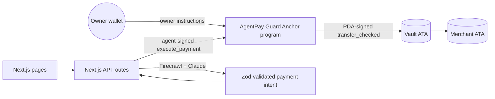

# AgentPay Guard — AI Agent Payment Firewall

> *Let AI transact. Never let AI bypass your payment rules.*

**Status (2026-11-28):** the on-chain program is complete and **deployed to Solana devnet** (`GvjcbQ2g7dg6ZNNBffhyVLmSz8ncbaEvL2c4M1Esayza`); the Next.js API (payments, AI agent, prompt-injection demo) and the Security Demo / Agent Playground pages work against devnet. **Not built yet:** wallet (Phantom) pages — Dashboard, Create Policy, Policy Details. **Not deployed yet:** the web app (Vercel). Every address and signature below is real and was re-checked on devnet.

**Tóm tắt (VI):** AgentPay Guard là lớp bảo mật thanh toán on-chain cho AI Agent trên Solana. AI có thể quyết định trả tiền cho ai, nhưng chính policy on-chain (Anchor Program) quyết định giao dịch có được phép hay không. Program đã chạy trên devnet; bằng chứng giao dịch thật ở mục [Devnet evidence](#devnet-evidence).

---

## Problem

AI agents that can pay are easy targets: prompt injection, hallucinated recipients, overspending, unapproved merchants, duplicate submissions, and no reliable kill switch. Off-chain guardrails fail when the backend or the model is compromised.

## Solution

The owner creates an on-chain **policy** and funds a **vault** whose only authority is the policy's program-derived address (PDA). The agent can only *request* payments. The Anchor program releases tokens only if:

- the signer is the policy's agent,
- the merchant is on the owner's on-chain allowlist,
- the amount is within the per-transaction and daily limits,
- the mint, vault, token program and merchant token account are the expected ones,
- the request hash is valid, unexpired and never used before,
- the policy is not paused.

AI decides what to pay. **On-chain policy decides whether it is allowed.**

## Features

| Feature | Status |
|---|---|
| Policy PDA + PDA-controlled vault (classic SPL Token) | DONE — tested, on devnet |
| Merchant allowlist, per-tx and daily limits (UTC day), payment events | DONE — tested, on devnet |
| Payment receipts, canonical request hash, replay protection, request expiry | DONE — tested, on devnet |
| Pause / resume, agent replacement, owner-only withdraw | DONE — tested (LiteSVM); pause/resume also on devnet |
| API: health, policy/merchant/payment reads, prepare/submit/status | DONE — verified on devnet |
| AI agent: Firecrawl + Claude (`claude-opus-5-5`, structured output) + Zod | DONE — unit-tested with a fake LLM; no live LLM run recorded yet |
| Prompt-injection demo (route + malicious page) | DONE — rejection verified on devnet (scripted agent output) |
| Security Demo (6 scenarios) + AI Agent Playground pages | DONE — all 6 scenarios verified on devnet; no visual browser QA yet |
| Wallet pages: Dashboard, Create Policy, Policy Details, Merchants, History (Phantom) | NOT BUILT YET |
| Vercel deployment | PREPARED (checklist + verification script), NOT DEPLOYED |
| x402 | FUTURE WORK (unverified) |

## Devnet evidence

Program: [`GvjcbQ2g7dg6ZNNBffhyVLmSz8ncbaEvL2c4M1Esayza`](https://explorer.solana.com/address/GvjcbQ2g7dg6ZNNBffhyVLmSz8ncbaEvL2c4M1Esayza?cluster=devnet) — deployed 2026-11-27 from commit `0223328`; on-chain bytes verified identical to the build (SHA-256 `107f5ced…1434`). Deploy tx [`3UxD5ioR…zWye`](https://explorer.solana.com/tx/3UxD5ioRCisM8Q3Lh6MANPZAWzhaiDgH4AmXTACHmUos5eVwCU9gbxGHbefdsvd1UMMjrTFpp1QCtPijxCnEzWye?cluster=devnet).

Policy `6opDP9Adejh378egiFscn5Z9Wxj3Xh26pgPt7NxRUskK` (test token, max 10 per tx / 20 per day), driven through the app's API:

| What happened | Result | Transaction |
|---|---|---|
| Agent pays the allowlisted merchant | **Paid** | [`22FHzVgQ…UM1q`](https://explorer.solana.com/tx/22FHzVgQY9SbgeVUrFWc9BAZKgMa1bcCqw7KMGSzUBCZCNbYc83tvrdRN7u3hFe46CYrVgx23dXeiMc5abi4UM1q?cluster=devnet) |
| Prompt-injected agent pays an attacker | **Rejected on-chain** — merchant not allowlisted (error 3012); balances unchanged | [`6iV1W5fu…HcUC`](https://explorer.solana.com/tx/6iV1W5fuJc3ZtPiYfWDgijLJagUziewFabc4e6mhxLFBK23hpqHV4UUMr11eVSkViJgorCz7T78cr2TAgdUHcUC?cluster=devnet) |
| Payment above the per-tx limit | **Rejected on-chain** — ExceedsMaxPerTx (6008) | [`3xjA76DM…N3K3`](https://explorer.solana.com/tx/3xjA76DMsx4ZyP74aYZNe7sNJoPBxStHP42RdVHbDDdtuXmoSvEU3GbuGLpbPVUtWqYX63EpjgaQnP5gN34yN3K3?cluster=devnet) |
| Same request submitted twice | **Rejected on-chain** — receipt already exists | [`2rai6BbY…Gt9Y`](https://explorer.solana.com/tx/2rai6BbYjeRkCZLRyVWeB97RCrqWr4Xh65eGXaRdShJ4SNY7F5Q5EqAfvbe4ZQcNMeGE9rvGbu9GXV3RpFJYGt9Y?cluster=devnet) |
| Payment while the owner paused the policy | **Rejected on-chain** — PolicyPaused (6000) | [`2yrSBkG2…U41pz`](https://explorer.solana.com/tx/2yrSBkG2WVpzEC4e35ohGYkNCEKpRBztAAGgbKM4cE8KLwLp4mf5bQsxqiHqfEC715BoVT1PtxoLtKuZELfU41pz?cluster=devnet) |

After all attacks, every non-allowlisted wallet still holds **0** tokens; the allowlisted merchant holds exactly the sum of the successful payments. The full record (17 signatures, audited against devnet 2026-11-28) is kept in `docs/evidence/DEVNET_EVIDENCE.md`.

## Architecture overview



## Technology stack

Solana devnet · Rust · Anchor 1.2.2 · Classic SPL Token + Associated Token Account programs · LiteSVM (program tests) · Next.js 16 (App Router, Route Handlers) · React 19 · TypeScript · Tailwind CSS · Zod · `@anchor-lang/core` + `@solana/web3.js` · Anthropic Claude · Firecrawl · Vitest · Vercel (planned). Phantom / Wallet Adapter: planned.

## Repository layout

```
anchor/    Anchor workspace — program `agent_payment_firewall` (8 instructions) + Rust/LiteSVM tests
app/       Next.js app — /api/v1 routes, /security and /agent pages, lib/ (anchor, solana, ai, server)
scripts/   sync-idl, create-test-mint, setup-demo, verify-deployment (Node; run devnet scripts in WSL)
docs/      specification and evidence (kept locally; not committed)
```

## Local setup

Windows: run Solana/Anchor in **WSL2 Ubuntu**; the Next.js app runs natively.

```bash
# program (WSL)
cd anchor && anchor build && anchor test
# app
cd app && cp ../.env.example .env.local   # fill values (never commit)
pnpm install && pnpm dev                  # http://localhost:3000 → /security, /agent
```

## Tests

```bash
cd anchor && anchor test     # 84 tests: Rust unit + LiteSVM integration (all 8 instructions, attacks, replay, overflow, UTC day)
cd app && pnpm test          # 131 tests: request hash & PDA vectors, error mapping, API services, AI agent, demo scenarios
cd app && pnpm typecheck && pnpm lint
```
Opt-in live run of the six demo scenarios against a running server on devnet: `app/src/lib/demo/scenarios.devnet.test.ts` (set `E2E_BASE_URL`).

## Demo

Open `/security?policy=<policy address>`: normal payment → prompt-injection attack → unauthorized merchant → excessive spending → duplicate payment → emergency pause. Each card shows what the firewall should do, what it did, the evidence type (on-chain failed transaction / simulation only / pre-check) and the vault balance before and after.

## Known limitations

1. **Does not detect or prevent prompt injection.** It enforces payment rules; a manipulated agent can still propose bad payments.
2. A manipulated agent paying an **allowlisted** merchant within limits **will succeed**.
3. Receipts prevent reuse of a request id/hash, not semantically duplicate payments with new ids.
4. Daily limits use UTC calendar days (up to 2× limit around midnight). Solana clock is approximate.
5. The demo agent key is stored server-side in an environment variable — hackathon custody, not production-grade.
6. Classic SPL Token only (no Token-2022); devnet only; one mint per policy.
7. x402 is not integrated.
