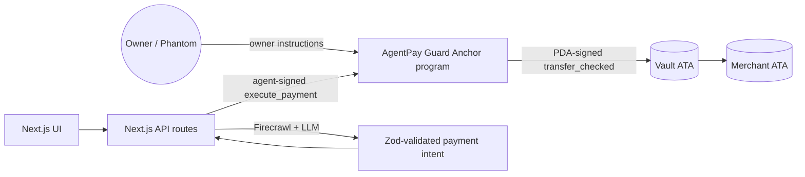

# AgentPay Guard — AI Agent Payment Firewall

> *Let AI transact. Never let AI bypass your payment rules.*

**Project status (2026-11-27): on-chain program complete (M1–M3) — all 8 instructions implemented, 79 tests passing (unit + LiteSVM integration), deployed to devnet as `GvjcbQ2g7dg6ZNNBffhyVLmSz8ncbaEvL2c4M1Esayza`.** The Next.js app, AI agent and demo (M4) are planned only. Addresses and signatures appear here only after they really exist.

**Tóm tắt (VI):** AgentPay Guard là lớp bảo mật thanh toán on-chain cho AI Agent trên Solana. AI có thể quyết định trả tiền cho ai, nhưng chính policy on-chain (Anchor Program) quyết định giao dịch có được phép hay không. Xem [docs/00_PROJECT_OVERVIEW.md](docs/00_PROJECT_OVERVIEW.md).

---

## Problem

AI agents that can pay are easy targets: prompt injection, hallucinated recipients, overspending, unapproved merchants, duplicate submissions, and no reliable kill switch. Off-chain guardrails fail when the backend or the model is compromised.

## Solution

The owner creates an on-chain **policy** and funds a **vault** whose only authority is the policy's program-derived address (PDA). The agent can only *request* payments. The Anchor program releases tokens only if:

- the signer is the policy's agent,
- the merchant is on the owner's on-chain allowlist,
- the amount is within the per-transaction and daily limits,
- the mint, vault, token program and merchant token account are the expected ones,
- the request hash is valid, unexpired and never used before,
- the policy is not paused.

AI decides what to pay. **On-chain policy decides whether it is allowed.**

## Features (planned)

| Feature | Status |
|---|---|
| Policy PDA + PDA-controlled vault (classic SPL Token) | IMPLEMENTED (M1, local tests) |
| Merchant allowlist, per-tx and daily limits, payment events | PLANNED (M2) |
| Payment receipts, canonical request hash, replay protection, expiry | PLANNED (M3) |
| Pause / resume, agent replacement, owner-only withdraw | PLANNED (M3) |
| Next.js dashboard + API, Phantom wallet | PLANNED (M4) |
| AI agent (Firecrawl + LLM + Zod) | PLANNED (M4) |
| Prompt-injection security demo with devnet evidence | PLANNED (M4) |
| x402 | FUTURE WORK (unverified) |

## Architecture overview



Details: [docs/02_SYSTEM_ARCHITECTURE.md](docs/02_SYSTEM_ARCHITECTURE.md).

## Technology stack

Solana devnet · Rust · Anchor · Classic SPL Token + Associated Token Account programs · Next.js (App Router, Route Handlers) · React · TypeScript · Tailwind CSS · Zod · Phantom + Solana Wallet Adapter · Anthropic Claude (LLM) · Firecrawl · Mocha/Chai (Anchor tests) · Vitest · Vercel.

## Repository layout

```
anchor/    Anchor workspace (program: agent_payment_firewall) — M1 implemented
app/       Next.js app: UI + /api/v1 — not yet created
scripts/   devnet setup / IDL sync scripts — not yet created
docs/      specification (this package)
```

## Local setup (once code exists)

Windows users: run Solana/Anchor inside **WSL2 Ubuntu**. Full guide: [docs/12_DEPLOYMENT_GUIDE.md](docs/12_DEPLOYMENT_GUIDE.md).

```bash
# program
cd anchor && anchor build && anchor test
# app
cd app && cp ../.env.example .env.local   # fill values
pnpm install && pnpm dev
```

## Test commands

```bash
cd anchor && cargo test -p agent_payment_firewall   # Rust unit tests
cd anchor && anchor test                            # build + unit + LiteSVM integration tests
cd app && pnpm test && pnpm typecheck && pnpm lint  # backend/frontend tests
```

## Devnet deployment

```bash
cd anchor && anchor program deploy --provider.cluster devnet   # `anchor deploy` still works but is deprecated in 1.2.2
node scripts/sync-idl.mjs
```
Program ID (devnet, deployed 2026-11-27): [`GvjcbQ2g7dg6ZNNBffhyVLmSz8ncbaEvL2c4M1Esayza`](https://explorer.solana.com/address/GvjcbQ2g7dg6ZNNBffhyVLmSz8ncbaEvL2c4M1Esayza?cluster=devnet). Evidence: `docs/evidence/DEVNET_EVIDENCE.md`.

## Demo

See [docs/13_HACKATHON_DEMO_SCRIPT.md](docs/13_HACKATHON_DEMO_SCRIPT.md): normal payment → prompt-injected payment rejected on-chain (Explorer evidence) → over-limit → duplicate → emergency pause.

## Known limitations

1. **Does not detect or prevent prompt injection.** It enforces payment rules; a manipulated agent can still propose bad payments.
2. A manipulated agent paying an **allowlisted** merchant within limits **will succeed**.
3. Receipts prevent reuse of a request id/hash, not semantically duplicate payments with new ids.
4. Daily limits use UTC calendar days (up to 2× limit around midnight). Solana clock is approximate.
5. The demo agent key is stored server-side in an environment variable — hackathon custody, not production-grade.
6. Classic SPL Token only (no Token-2022); devnet only; one mint per policy.
7. x402 is not integrated.

## Documentation

| Root | docs/ |
|---|---|
| [IMPLEMENTATION_PLAN.md](IMPLEMENTATION_PLAN.md) | [00 Overview](docs/00_PROJECT_OVERVIEW.md) · [01 Requirements](docs/01_PRODUCT_REQUIREMENTS.md) · [02 Architecture](docs/02_SYSTEM_ARCHITECTURE.md) |
| [TASKS.md](TASKS.md) | [03 Accounts](docs/03_ONCHAIN_ACCOUNT_DESIGN.md) · [04 PDAs](docs/04_PDA_DESIGN.md) · [05 Instructions](docs/05_ANCHOR_INSTRUCTIONS.md) |
| [AI_CODING_GUIDE.md](AI_CODING_GUIDE.md) | [06 API](docs/06_BACKEND_API_SPEC.md) · [07 Frontend](docs/07_FRONTEND_SPEC.md) · [08 AI agent](docs/08_AI_AGENT_DESIGN.md) |
| | [09 Threat model](docs/09_SECURITY_THREAT_MODEL.md) · [10 Testing](docs/10_TESTING_STRATEGY.md) · [11 Payment flow & replay](docs/11_PAYMENT_FLOW_AND_REPLAY.md) |
| | [12 Deployment](docs/12_DEPLOYMENT_GUIDE.md) · [13 Demo](docs/13_HACKATHON_DEMO_SCRIPT.md) · [14 x402](docs/14_X402_FUTURE_EXTENSION.md) · [15 ADRs](docs/15_ARCHITECTURE_DECISIONS.md) |
